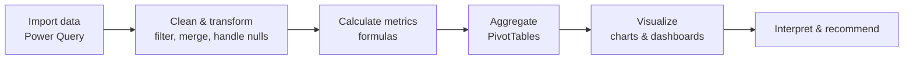

# Employee Attendance Analysis using Excel

**Data analytics project from the TNSDC Data Analytics program — turning raw attendance records into actionable workforce insights with Microsoft Excel and Power Query.**

---

## Table of Contents

- [Overview](#overview)
- [Problem Statement](#problem-statement)
- [End Users](#end-users)
- [Solution](#solution)
- [Dataset](#dataset)
- [Methodology](#methodology)
- [Analysis and Modelling Techniques](#analysis-and-modelling-techniques)
- [Key Insights](#key-insights)
- [Repository Contents](#repository-contents)
- [How to Use](#how-to-use)
- [Tools](#tools)
- [Author](#author)

---

## Overview

Organizations rely on attendance data to measure punctuality, manage schedules, and reduce absenteeism. When employees give their best at work, the organization flourishes — and attendance management is a practical way to monitor punctuality and performance.

This project analyzes employee records in Microsoft Excel to identify patterns, trends, and anomalies in attendance, and produces visual reports that support HR and management decisions. The full analysis and presentation are documented in [`GOKUL.pptx`](GOKUL.pptx).

## Problem Statement

Manual attendance tracking makes it difficult to spot absenteeism trends, late arrivals, and attendance anomalies across departments. Without structured analysis, managers cannot easily answer questions such as:

- Which departments have the highest absenteeism?
- Which periods show recurring attendance problems?
- How does attendance relate to performance and business unit?

## End Users

| User | How they use the analysis |
|---|---|
| **HR Managers** | Manage schedules, address absenteeism, ensure policy compliance |
| **Department Heads / Supervisors** | Optimize scheduling, balance workload, address performance issues |
| **Employees** | Track their own attendance patterns and improve time management |
| **Executives / Decision Makers** | Make strategic workforce and resource-allocation decisions |

## Solution

The project uses Excel's built-in analytics capabilities to turn raw attendance records into a clean, summarized, and visual dashboard:

- **Conditional formatting** to highlight missing values and anomalies
- **Filters** to remove or isolate missing records
- **Formulas** to calculate attendance levels, hours worked, and absence rates
- **PivotTables** to summarize data by employee, department, and period
- **Charts** to visualize attendance patterns and trends

## Dataset

An employee dataset sourced from **Kaggle**. The original dataset contains 26 features; the following 8 were selected for this analysis:

| Feature | Type | Description |
|---|---|---|
| `Employee ID` | Numerical | Unique employee identifier |
| `Name` | Text | Employee name |
| `Employee type` | Text | Employment category |
| `Performance level` | Text | Performance band |
| `Gender` | Categorical | Male / Female |
| `Employee Rating` | Numerical | Performance rating |
| `Employee status` | Numerical | Employment status |
| `Business unit` | Text | Department / unit |

## Methodology

1. **Import** — connect to and load the CSVs with Power Query.
2. **Transform** — filter rows, merge tables, and handle missing values inside Power Query.
3. **Automate** — configure refresh so the analysis stays current.
4. **Calculate** — derive attendance levels, hours worked, absence rates, and overtime.
5. **Aggregate** — summarize with PivotTables by employee, department, and period.
6. **Visualize** — build charts and dynamic dashboards.
7. **Interpret** — derive insights and recommendations.

## Analysis and Modelling Techniques

| Technique | What it does | Excel functions |
|---|---|---|
| Descriptive statistics | Mean / median attendance, variability | `AVERAGE`, `MEDIAN`, `STDEV.P`, `STDEV.S` |
| Time-series / trend analysis | Daily, weekly, monthly patterns | Line charts, PivotTables |
| Pivot summaries | Attendance by employee, department, period | `PivotTable`, `PivotChart` |
| Absenteeism analysis | Absence rates and correlations | `COUNTIF`, `COUNTIFS`, `CORREL` |
| Work-hours calculation | Hours worked and overtime | `DATEDIF`, `TEXT`, `SUM` |
| Anomaly detection | Late arrivals, early departures, outliers | `IF`, conditional formatting, z-score |
| Forecasting | Future attendance trends | `LINEST`, `FORECAST.LINEAR` |
| Scenario analysis | Policy-change what-if modelling | Data Tables, Goal Seek |

## Key Insights

- Attendance analysis revealed trends, anomalies, and areas for improvement across departments.
- Peak absenteeism periods and frequent late arrivals were identified.
- Attendance patterns correlate with departmental performance and business units.
- Recommended actions include flexible scheduling, stronger time-management practices, and clearer communication of attendance policies.

## Repository Contents

| File | Description |
|---|---|
| `GOKUL.pptx` | Full project presentation (problem statement, dataset, method, results, conclusion) |
| `README.md` | Project documentation |
| `LICENSE` | MIT license |

## How to Use

1. Download or clone the repository.
2. Open `GOKUL.pptx` to review the complete analysis, methodology, and results.
3. To reproduce the analysis, import the dataset into Excel via **Data → Get & Transform Data → From Text/CSV**, then apply the Power Query transformations and PivotTables described above.

## Tools

| Tool | Purpose |
|---|---|
| Microsoft Excel | Analysis, formulas, PivotTables, dashboards |
| Power Query | Data import, transformation, automation |
| Kaggle | Dataset source |

## Author

**Gokulakrishnan G**
[GitHub](https://github.com/Gokulgk6) · [LinkedIn](https://linkedin.com/in/gokulgk64)

## License

Released under the [MIT License](LICENSE).
